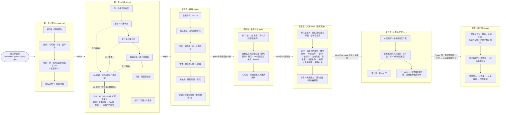

# 200 天礼物 · 全流程计划（GIFT_PLAN）

> 给 lushiva 的 200 天纪念礼物：**一个链接，四段旅程**。本文件是设计与技术的"唯一事实来源"（single source of truth）。
> 交接/进度见 [`HANDOFF.md`](./HANDOFF.md)；各工作流进度见 [`status/`](./status/)。
> 中文为主，技术细节附英文。最后更新：2026-11-03（M0 完成）。

---

## 0. 一句话

她打开链接 → **猫里奥式**像素闯关（明亮饱和）→ 经过喷泉，满屏红色像素爱心 → 推门 → 还是那只像素猫，**领着她逛一间小店**，店里陈列 lotus 亲手建模、打印的两个手办和两个冰箱贴（3D，可旋转缩放）→ 从后门出去，**天黑了**，画风变成《我的世界》式方块像素，伪纪录片式夜路，越走越不对劲，被什么东西追上、必输 → 被抓住的一瞬间，**画面翻转成超级粉嫩可爱**：抓住她的是那只小猪 → 进入**果冻标本**页面，最后她自己找到蘑菇彩蛋："200 天纪念日快乐，lushiva"。

## 1. 对愿景的理解（复述 + 设计判断）

| 原话要点 | 我的理解 / 设计决定 |
|---|---|
| "猫里奥那种闯关，但简单一点" | 借《猫里奥》(Syobon Action) 的**外观与幽默**：纯色天空、方砖、问号砖、会动的云——但**去掉"坑人"**：没有死亡、没有命数。掉坑 = 一团烟后在最近检查点重来；碰到小怪 = 轻轻弹开。"坑"变成**惊喜**（假砖块滑开露出弹簧、问号砖蹦出"!!"）。她不是玩家，是收礼物的人。 |
| 主角是照片里的猫，猫里奥风格像素猫 | 从 `ref_B_cat_book.jpg` 提炼：奶油白身体、软黑描边、**闭眼笑**（^ ^）、`:3` 嘴、粉色内耳、尾巴上一圈粉色环；招牌反应是头顶冒出黄色 **"!!"**（涂鸦原有元素）。16×16 像素，猫里奥式"大头小身"。第 1、2 关同一只猫。 |
| 喷泉：经过触发，**不断**喷像素爱心，整屏几秒 | 关卡末端的广场中央有像素喷泉。猫走过触发点：镜头锁定，喷泉持续 ~5 秒喷出红色像素爱心（三种红 + 高光），爱心飞满整屏、同时从屏幕上方落"爱心雨"；一路收集的爱心数计入，计数器滚到 **200**（呼应 200 天和果冻页彩蛋的里程表）。 |
| 继续往右，最右边是门，进门跳下一页 | 广场右侧一扇奶油色门（粉框、心形小窗）。走进门 → 猫转身背影 → 像素光圈收拢到门上 → 跳 `/shop/`。 |
| 第二个网页：网店，猫领着你从左走到右，展示两个手办两个冰箱贴，模型能像果冻页一样旋转、调整 | 一间温暖的像素小店（奶油墙、木地板）。4 个展台依次排开，每个展台上方是**真正的 3D 模型**（three.js 实时渲染，叠在像素世界上，跟着镜头滚动），平时缓慢自转。猫走近 → 浮出编辑式说明卡（编号/名字/尺寸/材料）+「看看」按钮；点开进入**检视模式**：拖动旋转、双指/滚轮缩放、双击复位、空闲自动转；附加"分色拆解"开关展示 AMS 四色件。冰箱贴陈列在一台**像素冰箱**门上。最右边是"后门"，门外是黑夜。 |
| 第三个：恐怖小游戏，氛围恐怖但内容不恐怖，整蛊；我的世界式像素；港鬼实录那种伪纪录片；走着走着有东西抓他；一定会输；Boss 是猪 | **第一人称**方块夜路（three.js 体素场景，16×16 像素贴图，最近邻采样），叠加**摄像机录像**滤镜（REC ●、时间码、噪点、暗角、轻微抖动/色散）。屏幕下方是一只**拿着火把的像素猫爪**（类似《我的世界》的手）——主角仍是那只猫。节奏：安静 → 不安（"别回头"的牌子、树间闪过黄色"??"、火把闪灭）→ 追逐（沉重脚步、"跑！"、回头能看到发光的眼睛和方块大轮廓）→ 死路、必被抓。 |
| 被抓那一瞬间画面变成很粉嫩很可爱的风格，大反差 | 被抓：镜头被强制转身，猪脸贴屏 0.25 s → 录像带雪花 0.35 s → **硬切**到全屏粉嫩"贴纸"风（**不是像素**，是圆润矢量）：粉色渐变、闪光、弹跳爱心，小猪抱住小猫，猪头顶的"??"变成"♥♥"，大字「抓到你啦！」。约 6 秒后（或点「继续」）进入果冻页。 |
| 最后是果冻网页，最后发现彩蛋 | 现有页面移到 `/jelly/`，原样保留（蘑菇彩蛋、烟花、里程表 200、"200 天纪念日快乐，lushiva"）。只加一个**可选**的极轻提示：从第 3 关进来、20 秒无操作时，蘑菇闪一下微光。 |
| 每段都短 | 每关 1–2 分钟，全程 ≈ 5–7 分钟（含果冻页）。 |
| 延续简洁高级的设计语言 | 所有 UI 文字（标题卡、按钮、说明卡、中/EN 切换）用果冻页同一套字体（Source Serif 4 / Noto Serif SC / Playfair Display 斜体），细线、留白、克制的配色；**游戏画面**才是像素/体素。像素是"作品"，UI 是"画框"。 |
| 手机、平板、电脑都能玩；国内不用 VPN | 全静态、无 CDN、字体与模型自托管；触屏按钮；竖屏/横屏都可玩；GitHub Pages 托管（风险与备选见 §10）。 |

## 2. 全流程（Flow）



## 3. 总体节奏与时长

| 章 | 路径 | 目标时长 | 情绪 | 画风 |
|---|---|---|---|---|
| 1 草地 | `/` | 60–90 s | 轻快、惊喜、甜 | 猫里奥式明亮像素（平涂、高饱和） |
| 2 小店 | `/shop/` | 60–120 s（看模型可更久） | 温柔、骄傲（"这是我做的"） | 暖色像素室内 + 真 3D 模型（PBR，像素世界里的"真东西"） |
| 3 夜路 | `/night/` | 60–80 s | 紧张 → 爆笑反差 | 方块体素 + 伪纪录片滤镜 → 粉嫩矢量贴纸 |
| 4 果冻 | `/jelly/` | 自由 | 安静、精致、感动 | 现有果冻标本页（+ 重力感应开关） |
| 5 天空 | `/sky/` | 30–90 s | 安静、辽阔、真实 | 深色、衬线、真实星表 + 星历 |
| 6 我们俩 | `/coop/` | 60–120 s | 合作、甜、收尾 | 草地同款像素（小猪 + 小猫） |
| （侧室）AR | `/ar/` | 自由 | 惊喜 | 纸面 + 3D 转台 / AR |

---

## 4. 共通设计（Design system）

### 4.1 视觉

- **UI 画框**：沿用果冻页（`src/ui/style.css`）的 tokens：`--ink #141414`、细线 `--hair`、`--pad`、`--ease`；字体 `Source Serif` + `Noto Serif SC Sub`，展示标题 `Playfair` 斜体（中文标题用 Noto Serif SC 500 + 字距）。已集中到 `src/shared/chrome.css`。
- **情侣色**（AMS 打印料色，贯穿全站）：奶油 `#FFF4E4`、浅粉 `#F9C6CF`、深粉 `#EE8FA6`、玫红 `#F08AA4`、软黑 `#2E2A2B`；辅色：书封蓝 `#9CC8EE`、黄 `#FFD45C`（"!!/??"）、叶绿 `#8FCB9B`、薰衣草 `#E4DCF5`（冰箱贴底板）、木色 `#E6C79F`。
- **像素纪律**：逻辑分辨率 + **整数倍放大**（`image-rendering: pixelated`），绝不半像素；绘制坐标取整；不做旋转/缩放的像素精灵（需要时预先画帧）。
- 每章顶部右上角统一：`声音开/关 | 中 / EN`（`mountChrome()`）。
- **标题卡**（`startCard()`）：章节 kicker（"第一章 · 草地"）+ 标题 + 一句副标题 + "轻触开始"，半透明纸色背景模糊；首次触摸同时解锁音频（iOS 规则）。

### 4.2 交互与控制（keyboard + touch + gamepad）

| 动作 | 键盘 | 触屏（仅 `pointer: coarse` 显示） | 手柄 |
|---|---|---|---|
| 左/右 | ←/→ 或 A/D | 左拇指 ◀ ▶（手指可在两键间滑动换向） | 左摇杆 / 十字键 |
| 跳 | 空格 / Z / ↑ / W / K | 右拇指 A（大圆） | A |
| 看看 / 互动 | E / X / Enter / J | 右拇指 B（只在可互动时出现） | X / B |
| 夜路：前进 | 按住 ↑ / W | 按住右下"前进"或按住屏幕下半区 | 左摇杆 ↑ |
| 夜路：环顾 | 鼠标拖动（可选 pointer lock） | 在屏幕其它位置拖动 | 右摇杆 |

触屏按钮：68–80 px、细白描边 + 半透明暗底 + 毛玻璃，按下缩小；全部 `touch-action: none`、pointer capture、多指安全；轻震 `navigator.vibrate(6)`（安卓）。实现：`src/shared/pixel/input.ts` + `touch.ts`。

**竖屏手机**：像素画布限制最大高度（关卡高度 15 格 = 240 px），按整数倍放大后居中；上方留白放 HUD/标题、下方留白放触屏按钮——按钮**不遮挡**游戏画面。页面背景用天空色→地面色渐变把留白"接"上，看不出边。横屏时按钮叠在地面上。可选提示"横过手机，视野更大"（只提示一次）。

### 4.3 音频决定

- **默认静音**（礼物常在公共场合打开；且 iOS 需手势）。右上角开关，选择持久化（`localStorage['gift.sound']`），跨章生效。
- **零音频文件**：全部 WebAudio 合成（`src/shared/audio.ts`）：第 1 关芯片音（跳、拾心、喷泉琶音），第 3 关氛围（风噪、蟋蟀、心跳、脚步、低沉"哼"），反转时一声清脆"叮~"（**不用尖叫**，整蛊不吓坏人）。
- 第 3 关标题卡多一行小字："建议打开声音 🎧"，并直接放一个开关。

### 4.4 可访问性 / 安全

- `prefers-reduced-motion`：减弱镜头震动、关闭闪烁；第 3 关闪光 ≤ 3 次/秒（光敏安全）。
- 所有按钮有 `aria-label`（随语言切换）；canvas 有 `aria-label` 描述。
- 卡关保护（礼物不能卡住）：同一个坑掉 3 次 → 出现一排爱心砖桥；任何章节右上角在**重玩时**（`gift.progress` 已到达下一章）出现"跳过"。

---

## 5. 分章设计

### 5.1 第一章 · 草地（`/`，meadow）— 猫里奥式明亮像素平台

**故事节拍**
1. 标题卡「第一章 · 草地 / 出发吧，小猫 / 一直往右走，尽头有东西等你」。
2. 小猫从左边坐着起身，头顶冒"!!"，开始走。
3. 学走与跳 → 问号砖（蹦出像素爱心 / 一次蹦出"!!"）→ 慢吞吞的小蘑菇怪（踩一下变成爱心；碰到只是被弹开）→ 带笑脸的云平台（猫里奥梗，但云是友好的）→ 一个"假地砖"慢慢滑开，露出弹簧把猫弹上一串爱心（梗变惊喜）→ 检查点小铃铛。
4. **喷泉广场**：石板地、花、长椅。猫走过喷泉触发点：输入锁定 ~1.5 s，镜头居中，喷泉持续 5 s 喷红色像素爱心（粒子：初速向上 + 扇形散开 + 重力 + 少量随风飘，屏幕上方同时下"爱心雨"），HUD 爱心计数快速滚到 **200**；然后输入恢复，爱心慢慢落完。
5. 右侧尽头的门：靠近时门自动开一条缝透出暖光；走进去 → 猫背影 1 帧 → 像素光圈收拢到门 → `/shop/`。

**美术方向**：《猫里奥》式平涂明亮——天空蓝、白云、草绿方块、土橙、砖红、问号砖金黄；角色 1 px 软黑描边，地形不描边、用 1 px 高光/暗边体现体积。整体比原版更"精致"：配色统一在 ~20 色调色板内，云和远山做 2 层视差。

调色板（建议，可微调）：

| 用途 | HEX |
|---|---|
| 天空 / 天空下沿 | `#5EC4FF` / `#9ADCFF` |
| 云 / 云影 | `#FFFFFF` / `#D6F0FF` |
| 草 / 草暗 | `#4CC25A` / `#2E9E48` |
| 土 / 土暗 | `#D9843F` / `#A65C2A` |
| 砖 / 砖缝 | `#E0663A` / `#9E3F22` |
| 问号砖 / 暗 | `#FFC83D` / `#E08A12` |
| 爱心 红 / 深红 / 高光 | `#FF3B5C` / `#C81E45` / `#FF9BB0` |
| 水 / 喷泉石 / 石影 | `#3FA9F5` / `#ECE6DA` / `#BDB2A2` |
| 描边 / 猫奶油 / 猫粉 | `#2E2A2B` / `#FFF4E4` / `#F4A7B9` |

**精灵清单（sprites）**——全部用代码里的字符画（string art）+ 调色板生成（`src/shared/pixel/sprite.ts`），无图片文件：
- 猫（16×16）：idle 2 帧（眨眼/尾巴摆）、walk 4 帧、jump 上升 1 帧 + 下落 1 帧、落地挤压 1 帧、背影 1 帧（进门）、开心 2 帧（喷泉时）、"!!" 气泡（5×5）。→ `src/shared/pixel/cat.ts`（目前是第一版占位，需精修）。
- 地形 16×16：草顶/草角、土、砖、问号砖（2 帧闪 + 空砖）、管子/台阶石、木桥、单向平台、花草装饰、栅栏、长椅、路牌。
- 小蘑菇怪（16×16，2 帧走 + 被踩扁 1 帧）——蘑菇是对果冻页彩蛋的伏笔。
- 云平台（48×16，带笑脸 2 帧）、弹簧（16×16，2 帧）、检查点铃铛（2 帧）。
- 喷泉（48×48，水流 4 帧循环）、像素爱心 7×6（3 色变体）+ 大爱心 11×10。
- 门（32×48：关、半开发光、全开）。
- 远景：大云（64×24）、山丘（2 层视差，128 宽可平铺）。

**关卡草图**（1 格 = 16 px，高 15 格，总长 ≈ 210 格 ≈ 3360 px；跑速 96 px/s → 纯走 ~35 s，含玩法 60–90 s）。字符地图写在 `src/stages/meadow/level.ts`：

```
x:  0        20        40        60        80        100       120       140       160       180       200 210
    |S  学走   |小坑  台阶 |??? ?! 砖行  |蘑菇怪 x2   |云平台 + 水 |假砖→弹簧↑♥|铃(检查点) |  ⛲ 喷泉广场    |   门 D |
    ~~~~~~~~~~~~~~~  __  ~~~~~~~~~~~~~~~~~~~~~~~~~~~~  ~~~~ ≈≈≈≈ ~~~~~~~~~~~~~~~~~~~~~~~~~~~~~~~~~~~~~~~~~~~~~~~~
```

**玩法参数**（`FEEL` in `tiles.ts`，偏宽容）：跑速 96 px/s、跳初速 330 px/s（≈ 3.5 格高）、土狼时间 0.1 s、跳跃缓冲 0.12 s、松手矮跳；坑最宽 3 格；无伤害、无计时。

**验收**：手机竖屏/横屏、平板、桌面均 60 fps；全程无死亡画面；喷泉 ≥ 5 s 满屏爱心；进门跳转 `/shop/`；中/英切换即时；首屏 JS ≤ 60 KB gzip。

### 5.2 第二章 · 小店（`/shop/`）— 像素猫领逛 + 真 3D 模型

**故事节拍**
1. 光圈打开：猫从店的左门进来（门上挂 OPEN 牌、门铃"叮"）。标题卡「第二章 · 小店 / 我为你做的小东西」。
2. 展台 No.01 小猪手办 → No.02 小猫手办 → No.03/04 像素冰箱门上的两个冰箱贴 →（可选 No.05）情侣拼合台：两个手办在桌上滑到一起，燕尾榫合上、接缝上的半颗心拼成一颗。
3. 店最右边是"后门"：靠近时店内灯闪两下、门缝外是黑的（预告第 3 章）。走进去 → 光圈关 → `/night/`。

**3D 呈现方式（关键设计）**
- **一个**全屏透明 WebGL 画布叠在像素画布之上（`pointer-events` 只在检视时开启）。每个展台在像素世界有一个锚点；每帧用 `screen.toClient()` 把锚点换算成屏幕坐标，用 `renderer.setScissor/setViewport` 在那块区域渲染对应模型 → 模型"站"在像素展台上，随镜头滚动，平时缓慢自转（0.25 rad/s）。只渲染屏幕内的 1–2 个。
- 猫靠近展台（±2 格）：浮出说明卡（DOM，编辑式排版）：`No. 01 · 小猪 · 敲电脑 · PLA · AMS 四色 · 59.9 × 31.9 × 41.4 mm · Bambu Lab A1 mini`，以及「看看」按钮（触屏 B 键 / E / Enter / 直接点模型）。
- **检视模式**：像素世界暗下 + 轻微模糊（CSS filter 在像素画布上），该模型的视口平滑放大到屏幕中央；`OrbitControls`（拖动旋转、滚轮/双指缩放、禁用平移、阻尼、限制俯仰），双击复位，4 s 无操作自动转；底部细线按钮：「复位 · 分色拆解 · 关闭」。**分色拆解**：GLB 里每个颜色是独立 mesh，沿各自质心方向偏移、带缓动，展示 AMS 四色打印的拆件（对应 `_color_parts/`）。可选彩蛋：点击模型时做一次"果冻 Q 弹"顶点挤压（`onBeforeCompile` 加一个衰减正弦形变），呼应终章。
- 光照：`RoomEnvironment` + PMREM（程序生成，无 HDR 文件）+ 一盏柔和主光；`NeutralToneMapping`（颜色接近打印料色 / 预览渲染）；模型下方用径向渐变贴图做接触阴影（便宜且好看）。PLA 质感：roughness 0.58、metal 部件 0.32/0.55（已在导出脚本设好）。

**美术方向（像素部分）**：暖色室内——奶油墙 `#F6EFE4`、护墙板、木地板 `#E6C79F/#C99A6B`、展台白、玻璃罩高光、吊灯光斑、墙上小画框（可放 lotus 的预览渲染缩成像素版？——不，保持像素纯粹，墙上画像素小猪/小猫肖像）。和第 1 关同一只猫、同一套 UI，室内配色更柔和。

**精灵清单**：店门（OPEN 牌）、墙/护墙板/地板瓷砖、展台（32×24）+ 玻璃罩高光、像素冰箱（32×64，门上两个磁贴的位置是 3D 锚点）、吊灯（2 帧）、盆栽、收银台、后门（暗缝 + 闪灯）、猫（复用 `cat.ts`）。

**关卡草图**（高 12 格，长 ≈ 110 格；平地为主，偶尔一个台阶让跳跃有用）：

```
x: 0     10        25        40        55        70        85        100 110
   |门 S |  No.01 猪手办 | No.02 猫手办 | 冰箱 No.03/04 | (No.05 拼合台) | 收银台 | 后门 D |
   ================================================================================
```

**展品数据**（来自 3D 仓库 `docs/PROJECT_README_v5.md`）：

| No. | id | 名称 | 尺寸 mm (X×Y×Z) | 分色零件 |
|---|---|---|---|---|
| 01 | `figure-pig` | 小猪 · 敲电脑（立体手办 round） | 59.9 × 31.9 × 41.4 | 12 |
| 02 | `figure-cat` | 小猫 · 捧着书（立体手办 round，书上 "Eblana!"） | 61.9 × 31.9 × 47.8 | 15 |
| 03 | `magnet-pig` | 小猪 · 冰箱贴（浮雕，Ø8 磁铁槽） | 70.1 × 55.0 × 10.4 | 13 |
| 04 | `magnet-cat` | 小猫 · 冰箱贴（浮雕，薰衣草底板） | 70.1 × 55.0 × 8.9 | 15 |
| 05（可选） | `pair` | 情侣拼合（燕尾榫 + 接缝上的半颗心） | — | — |

打印用的 AMS 主色：奶油 `#FFF4E4`、浅粉 `#F9C6CF`、深粉 `#EE8FA6`、软黑 `#2E2A2B`（网页模型保留全部零件色，和预览渲染一致）。

**3D 资产管线**（已跑通，见 §7.2）：`public/models/{figure-pig,figure-cat,magnet-pig,magnet-cat}.glb`，每个 ≈ 410 KB（meshopt 压缩，~9 万三角形）。按距离懒加载：进店先加载 No.01，猫走到上一个展台时预载下一个。

**验收**：4 个模型都能在手机上流畅旋转缩放（≥ 50 fps，iPhone 12 级）；颜色与 `lotus-3d-figures/previews` 一致；检视模式可用触摸完成全部操作且不会误触移动猫；模型加载期间展台显示细线进度；走到后门进入 `/night/`。

### 5.3 第三章 · 夜路（`/night/`）— 方块体素 · 伪纪录片 · 必被抓 · 粉嫩反转

**为什么做第一人称体素（而不是 2D 横版）**：①"我的世界"的辨识度来自方块 + 像素贴图的**立体**世界，2D 很难做出来；②伪纪录片（港鬼实录式）= 手持摄像机视角，第一人称才有"背后有东西"的压迫感；③控制反而更简单——只需"按住前进"（沿固定小路，不会迷路）+ 可选拖动环顾；④ three.js 已经为第 2 章打包，浏览器缓存复用，几乎零额外下载。主角仍是猫：画面下方有一只拿火把的像素猫爪（像《我的世界》的手），走路时上下摆动。
（备选 Plan B，若性能/时间不允许：2D 横版 + 方块贴图 + 手电光锥，同样的剧情节拍，复用 `shared/pixel`。）

**故事节拍（~70 s，全部脚本化、按距离/时间触发）**

| t / 距离 | 事件 |
|---|---|
| 0 s | 黑屏，录像机开机：雪花 → "REC ●"、时间码 `00:00:00`、日期 `DAY 200`、电量图标；标题卡「第三章 · 夜路 / 别回头 / 按住前进，别离开小路」+ "建议打开声音 🎧" |
| 0–20 s | 方块森林里的碎石小路，雾、萤火虫、火把光圈；蟋蟀 + 脚步沙沙 |
| ~20 s | 路边木牌「别回头」；远处一块孤零零的**粉色方块**（伏笔） |
| ~30 s | 树缝间闪过两颗黄色 "??"（猪涂鸦头顶的问号，这里是伏笔）；火把熄灭 0.5 s 又亮 |
| ~38 s | 前方远处一个方块大轮廓横穿小路；蟋蟀声突然停 |
| ~45 s | 身后沉重脚步 + 低沉"哼"；屏幕中央小字「跑！」；自动加速、镜头晃动；如果回头（拖动）能看到两点发光眼睛和越来越近的方块剪影 |
| ~55 s | 小路尽头是一道方块墙 / 铁栅门（死路）。不管怎么操作，追兵都会在 ~58 s 追上（停下也会被追上） |
| 抓住 | 镜头被强制转身 180°，猪脸（暗、红眼）贴满屏 0.25 s → 录像带雪花 + 画面撕裂 0.35 s → **硬切** |
| 反转 0–6 s | 全屏粉嫩**矢量贴纸**风：`#FFE4EC → #F9C6CF` 渐变、闪光星星、软弹的爱心；小猪（根据涂鸦矢量化：圆润粗白描边、腮红）抱住小猫，猪头顶 "??" 变成 "♥♥"；大字「抓到你啦！」+「一直跟着你的，是我呀。」；轻"叮~" |
| 6 s 后 | 「继续 →」按钮（或 8 s 自动）→ 粉色光圈 → `/jelly/?from=night` |

**美术方向**
- 体素世界：16×16 程序生成像素贴图（运行时在 canvas 上画：草顶/草侧、泥土、石头、碎石、橡木/白桦原木、树叶（镂空）、木牌、火把），`NearestFilter`、无 mipmap 模糊；`InstancedMesh` 每种方块一个；雾色 `#05070d`；只有火把点光（暖橙 `#ffb35c`，轻微闪烁）+ 极弱月光（冷蓝）。**不使用任何 Minecraft 官方素材/字体**，只是风格致敬。
- 伪纪录片后期（一个全屏 shader pass，或 CSS 叠层）：胶片噪点、扫描线、暗角、轻色散、偶发撕裂；REC/时间码用小像素字体（自绘 5×7，数字+大写字母）。
- 猪 Boss（体素）：像《我的世界》猪的方块结构（身体、头、鼻子方块、耳朵），用情侣色上色——浅粉 `#F9C6CF`、鼻子 `#EE8FA6`、黑眼；在黑暗里只看见被火把照到的局部和两点发光眼（追逐时眼睛发红光，反转时变回黑豆眼）。头顶漂着两个黄色 "??" 方块。
- 粉嫩反转：**非像素**的矢量风（SVG + CSS 动画）——与前面的黑暗像素形成最大反差。猪和猫用涂鸦描线矢量化（potrace）后上色，粗白描边贴纸效果；字体仍用站点字体（Playfair 斜体 / Noto Serif SC 粗）加粉色描边。

**验收**：手机竖屏可完成（按住前进即可）；任何操作都会在 ≤ 60 s 内被抓；反转画面在 0.1 s 内完成切换、无白闪；全程 ≥ 45 fps（中端手机）；闪光符合光敏安全；进入 `/jelly/`。

### 5.4 终章 · 果冻标本（`/jelly/`）

- 原页面整体移到 `jelly/index.html`；运行时资源移到 `public/jelly/assets/`（代码里的 `./assets/...` 是相对页面的，所以无需改代码）。蘑菇彩蛋、烟花、里程表、"200 天纪念日快乐，lushiva"保持不变。
- 可选（M7）：`?from=night` 时 20 s 无操作，蘑菇图标做一次微光（CSS，1 次，不打扰）。不改彩蛋本身。

---

## 6. 技术架构

### 6.1 决定：同仓库 Vite 多页面应用（MPA）

```
/            index.html        → src/stages/meadow/main.ts   第一章（她打开的链接）
/shop/       shop/index.html   → src/stages/shop/main.ts     第二章
/night/      night/index.html  → src/stages/night/main.ts    第三章
/jelly/      jelly/index.html  → src/main.ts                 终章（原果冻页，代码未动）
```

理由：①每章独立加载，第一章极小极快（第一印象）；②章与章是真正的"网页跳转"，符合用户想要的"一个网页跳到另一个网页"，浏览器返回键也自然；③共用一套字体/工具/构建/部署；④各工作流文件互不重叠，可并行开发。
`vite base './'` → 所有 URL 相对，部署在 `/jelly-gift/` 子路径下也正常。

### 6.2 模块

```
src/shared/                 ← 所有章节共用（API 冻结，只做"加法"修改）
  flow.ts                   章节表、stageUrl()、go()、prefetchNext()、asset()、进度、?stage= 跳转、dev 参数
  i18n.ts / dict.ts         通用 i18n（与果冻页同一个 localStorage 键 'jelly.lang'），各章 register() 自己的词典
  chrome.ts / chrome.css    设计 tokens、字体 @font-face、中/EN + 声音开关、标题卡、触屏按钮样式
  audio.ts                  WebAudio 合成器，默认静音
  transition.ts             阶梯式像素光圈 irisOut()/irisIn()（DOM 层，适用于 2D/3D/果冻页）
  pixel/                    2D 像素引擎（第 1、2 章；第 3 章 Plan B）
    screen.ts               整数倍放大画布、逻辑分辨率、坐标换算 toClient()/toLogical()
    loop.ts                 60 Hz 固定步长 + 插值渲染；window.__pause / __steps（截图用）
    input.ts / touch.ts     键盘/触屏/手柄 → 动作（left/right/up/down/jump/act）
    tiles.ts                字符地图、AABB 瓦片碰撞、平台跳跃手感（FEEL）
    camera.ts               前瞻跟随、钳制、整数偏移
    sprite.ts               字符画 + 调色板 → canvas 精灵、动画
    cat.ts                  主角像素猫（第 1、2 章共用）
    stubwalk.ts             脚手架临时场景（章节做完后删除引用）
src/stages/<meadow|shop|night>/   各章私有：main.ts、dict.ts、style.css（+ level.ts、sprites.ts、viewer.ts ...）
src/(app|characters|core|egg|i18n|render|sim|ui)/ + src/main.ts   果冻页（原样）
public/jelly/assets/        果冻网格 .bin（30 MB，懒加载，按角色按画质）
public/models/              第 2 章 GLB
```

### 6.3 3D 查看器：选 three.js（npm，tree-shaken），不复用果冻渲染器

- 果冻渲染器是为"SDF 烘焙的四面体软体 + XPBD 模拟"定制的 WebGPU/WebGL2 管线，没有通用网格/材质/glTF 加载能力；改造成本高、风险大，且会把果冻页的代码和第 2 章耦合。
- three.js 提供：`GLTFLoader` + `MeshoptDecoder`（解码器以内嵌 wasm 的 JS 模块形式打包，**无 CDN**）、`OrbitControls`、PBR、`RoomEnvironment`、`InstancedMesh`（第 3 章体素）——两章共用同一个 chunk（Vite 自动拆分，第 3 章时已在缓存中）。iOS Safari WebGL2 稳定。
- 体积：three 核心 + 加载器 + 控制器 ≈ 150–190 KB gzip，只在 `/shop/`、`/night/` 加载；第 1 章不碰。
- 已安装 `three@0.187` + `@types/three`。只用具名导入（`import { WebGLRenderer } from 'three'`），按需导入 `three/examples/jsm/...`。

### 6.4 路由与进度传递

- 纯 URL 路径：`/` → `/shop/` → `/night/` → `/jelly/`。跳转用 `go()`：标记进度 → 出场动画 → `location.assign(stageUrl(next, { from: here }))`。
- 跨页携带参数：`lang`、`dev`、`sound`、`skip`（`flow.ts` 的 `CARRY`）。另加 `from=<上一章>`。
- 进度：`localStorage['gift.progress']` = 到达过的最远章节序号（0–3）。只用于"重玩时显示跳过"和调试，**不做强制门禁**（直接打开 `/jelly/` 也能看）。
- 开发直达：`/?stage=2|shop|3|night|4|jelly` 在第一章启动前重定向（`handleStageParam()`）。
- 其它 dev 参数（约定，各章实现）：`?dev`（FPS、碰撞框、可点击跳关）、`?at=<checkpoint>`（如 `?at=fountain`、`?at=exit`、`?at=chase`）、`?skip`（跳过标题卡）、`?sound=1`。
- 预加载：猫接近出口时 `prefetchNext()`（`<link rel=prefetch>` 下一页 HTML）；第 2 章靠近后门时可额外 `import()` 第 3 章模块预热。

### 6.5 i18n

- 每章 `dict.ts` 导出 `en` 与 `zh`（键以章节名为前缀：`meadow.*`、`shop.*`、`night.*`，类型保证两种语言键一致）；`register(dict)` 合并进共享表；DOM 用 `data-i18n` / `data-i18n-aria`。
- 语言选择与果冻页共享 `localStorage['jelly.lang']`，在任一章切换都会延续到后面每一章。
- `<title>` 由 vite 插件在构建时用英文填 `%T:key%`，运行时 `apply()` 按 `<meta name="gift-title">` 换成当前语言。
- 游戏画面内尽量**不放文字**；必须的文字（"跑！"、"抓到你啦！"）用 DOM 叠层（站点字体），录像时间码等用自绘像素字体（只含数字/大写字母）。
- **改了中文文案后必须 `npm run fonts`** 重新子集化 Noto Serif SC（否则新字回退系统宋体）。

### 6.6 性能预算

| 项 | 预算 |
|---|---|
| 第 1 章首屏（HTML+CSS+JS，不含字体） | ≤ 60 KB gzip；标题卡 < 1 s 可见（4G） |
| 字体 | Noto Serif SC 子集 ~40 KB、Source Serif ~330 KB（已有，可考虑只加载 400 字重的子集优化） |
| 第 2 章 | three chunk ≤ 200 KB gzip；4 个 GLB 共 ≤ 2 MB，懒加载；首个模型 < 2 s 出现 |
| 第 3 章 | 额外 JS ≤ 40 KB gzip（three 已缓存）；无模型文件；体素实例 ≤ 8k；draw calls ≤ 30 |
| 帧率 | 像素章 60 fps（中端手机）；3D 章 ≥ 50 fps（iPhone 12 级），DPR 上限 2 |
| 内存 | 3D 章 GPU 纹理/几何 ≤ 150 MB |
| 像素绘制 | 静态瓦片层预渲染成若干 256 px 宽的离屏条带，每帧只 blit 可见条带 + 动态精灵 |

---

## 7. 资产管线

### 7.1 像素精灵（从涂鸦到像素）

1. **手绘思路，代码落地**：以涂鸦为造型参考（`/workspace/figure-project/refs/`，3D 仓库 `refs/` 也有），提炼最有辨识度的 4–5 个特征（猫：闭眼笑、:3、粉内耳、尾巴环、"!!"；猪：大圆鼻孔、竖耳、腮红、"??"、笔记本电脑），在 16×16（猫/小怪）或 24×24（猪 Boss 2D 备选）格子里画。
2. 用**字符画 + 调色板**写进 TS（`sprite.ts` 的 `raster()`），每个字符一个像素，'.' 透明。好处：可 diff、任何 AI 都能改、零图片文件、零加载。
3. 审稿工具（建议工作流 A 建）：`tools/pixel/sheet.mjs` 把所有精灵导出成放大 8× 的 PNG 联系表到 `review/sprites/`，方便看图迭代。
4. 规则：1 px 软黑 `#2E2A2B` 外描边；内部不描黑线，用一档暗色表示体积；光源统一左上；每个角色 ≤ 6 色。
5. 第 3 章体素贴图同理，用代码生成 16×16 噪点贴图（固定随机种子，保证每次一样）。
6. 粉嫩反转的矢量猪/猫：用 `potrace`（或手写 SVG path）从涂鸦描线生成 SVG，再上色、加粗白描边，存 `src/stages/night/art/*.svg`（内联打包）。

### 7.2 3D 模型 → 网页 GLB（**已完成并提交**）

源：私有仓库 `smartlotus/lotus-3d-figures`（本机 `/workspace/lotus-3d-figures-repo`）。有的格式：单色 STL、彩色 3MF、彩色 OBJ+MTL（每个颜色一个对象/材质）、分色零件 STL、装配好的 `.blend`。选用 **v5 round 手办 + v5 冰箱贴的彩色 OBJ+MTL**（颜色/零件结构最完整，适合网页）。

```
tools/models/compress.sh          # 一键：OBJ+MTL → Blender 导入/减面/材质 → GLB → gltf-transform meshopt
tools/models/export_glb.py        # Blender 4.2 headless 脚本（Z-up mm → glTF Y-up，1 单位 = 10 cm）
```

| 输出 | 源 | 三角形 | 大小 |
|---|---|---|---|
| `public/models/figure-pig.glb` | `Figure_A_Pig_v5_round_color.obj`（分色 OBJ 数十万面） | ~9 万 | 410 KB |
| `public/models/figure-cat.glb` | `Figure_B_Cat_v5_round_color.obj` | ~9 万 | 419 KB |
| `public/models/magnet-pig.glb` | `Relief_A_Pig_v5_color.obj` | ~9 万 | 413 KB |
| `public/models/magnet-cat.glb` | `Relief_B_Cat_v5_color.obj`（~60 万面） | ~9 万 | 423 KB |

- 每个颜色是独立 mesh + 材质（名字如 `08_pink`、`cream`），方便"分色拆解"和单独调材质。
- 目标：每个 ≤ 500 KB；如果手机上偏慢，`TRIS=60000 tools/models/compress.sh` 重导。
- three 端：`const loader = new GLTFLoader().setMeshoptDecoder(MeshoptDecoder)`，URL 用 `asset('models/figure-pig.glb')`。
- 可选 No.05 情侣拼合：用 `Figure_A_Pig_v5_pair_round_color.obj` + `Figure_B_Cat_v5_pair_round_color.obj`（装配平移 dx = 60.8493 mm，见 3D 仓库 `docs/PROJECT_README_v5.md`）。
- 说明卡数据（尺寸、色表、零件）从 3D 仓库 `docs/PROJECT_README_v5.md` 第 4 节取。

---

## 8. 里程碑与验收

| # | 里程碑 | 归属 | 验收标准 |
|---|---|---|---|
| M0 | 计划 + 交接文档 + MPA 脚手架 + 共享引擎雏形 + GLB 管线 | 已完成 | `npm run build` 通过；`/ → /shop/ → /night/ → /jelly/` 可全程点通；果冻页在 `/jelly/` 正常；4 个 GLB 已生成 |
| M1 | 共享像素引擎定稿 + 猫精灵定稿 + 精灵审稿工具 | A | 猫 idle/walk/jump/fall/land/back/happy 全部帧；`review/sprites/*.png`；触屏在 iOS/Android 无粘键；竖屏布局（画布上移、按钮在下方留白） |
| M2 | 第一章完整关卡 + 喷泉 + 门 | A | §5.1 全部节拍；60–90 s；喷泉 ≥ 5 s 满屏爱心 + 计数到 200；无死亡；卡关保护；60 fps |
| M3 | 3D 查看器模块（独立可测） | B | `src/stages/shop/viewer.ts`：加载 GLB、轨道控制、复位、自动转、分色拆解、视口跟随锚点；`/shop/?dev&viewer` 可单独查看 4 个模型；颜色与预览一致 |
| M4 | 第二章像素小店 + 展台集成 + 后门 | B | §5.2 全部节拍；检视模式触屏可用；懒加载；≥ 50 fps |
| M5 | 第三章体素世界 + 前进/环顾 + 录像滤镜 | C | 体素森林小路、火把、雾、猫爪；按住前进；REC 叠层；≥ 45 fps |
| M6 | 第三章追逐 + 必被抓 + 粉嫩反转 + 跳转 | C | §5.3 全部节拍；≤ 60 s 必被抓；反转无白闪；矢量猪抱猫动画；进入 `/jelly/` |
| M7 | 整合：果冻页到达提示（可选）、全站文案润色、`npm run fonts`、音效 | 整合人 | 中英文文案定稿；所有中文字形在子集内；三章音效（默认静音） |
| M8 | 跨设备 QA + 性能 + 部署 | 整合人 | iPhone Safari / 安卓 Chrome / iPad / 桌面 Chrome/Safari/Edge 全流程通过；`scripts/deploy_pages.sh` 部署；线上 `https://smartlotus.github.io/jelly-gift/` 打开即第一章 |

## 9. 并行工作流（文件归属）

| 工作流 | 负责 | **只能改**（拥有） | 只读使用 |
|---|---|---|---|
| **A · 草地 + 像素引擎** | M1, M2 | `index.html`、`src/stages/meadow/**`、`src/shared/pixel/**`、`tools/pixel/**`、`review/stage1-meadow/**`、`docs/status/A.md` | `src/shared/*.ts`（顶层） |
| **B · 小店 + 3D** | M3, M4 | `shop/index.html`、`src/stages/shop/**`、`public/models/**`、`tools/models/**`、`review/stage2-shop/**`、`docs/status/B.md` | `src/shared/**`（含 pixel，作为消费者） |
| **C · 夜路 + 反转** | M5, M6 | `night/index.html`、`src/stages/night/**`、`review/stage3-night/**`、`docs/status/C.md` | `src/shared/**` |
| 整合人（主控） | M0, M7, M8 | `src/shared/*.ts|css`（顶层）、`vite.config.ts`、`package*.json`、`scripts/**`、`tools/fonts.py`、`src/assets/fonts/**`、`docs/GIFT_PLAN.md`、`docs/HANDOFF.md`、果冻页代码 | — |

规则：
- B 需要像素引擎新功能 → 先在 `src/stages/shop/` 里本地扩展（包装/继承）；确实要改共享引擎时在 `docs/status/B.md` 写需求，由 A 实现（或协调后由 B 做**纯新增**的文件）。
- 需要新 npm 依赖 → 单独一个小提交只改 `package*.json`，提交前 `git pull --rebase`。
- **不要提交重新生成的字体**（二进制冲突），中文新字先用系统字回退，M7 统一 `npm run fonts`。
- 每次提交前 `git pull --rebase origin master`，提交后立即 `git push origin master`。禁止 force-push。

## 10. 风险与对策

| 风险 | 影响 | 对策 |
|---|---|---|
| GitHub Pages 在国内偶尔慢/不稳定 | 打不开就没有礼物 | dist 全相对路径、全静态，可直接上传到任意静态托管（腾讯云 COS / 阿里云 OSS 静态网站、自有服务器）；M8 在国内网络实测；大文件（果冻 .bin 30 MB）都是按需懒加载 |
| 第一章对非玩家太难 | 卡关、扫兴 | 宽容手感参数、无死亡、坑最宽 3 格、掉坑 3 次自动铺爱心桥 |
| 手机上 3D 卡顿 / 发热 | 第 2、3 章体验差 | DPR 上限 2、只渲染屏幕内模型、GLB 可重导更低面数、体素实例化、空闲时降帧 |
| iOS Safari 怪癖（音频需手势、100vh、橡皮筋滚动、双击缩放） | 交互异常 | 标题卡手势解锁音频；`position: fixed; inset: 0` 不用 100vh；`touch-action: none`、`overscroll-behavior: none`、viewport 禁缩放 |
| 恐怖章节真吓到人 | 违背"整蛊"初衷 | 不用尖叫/血腥/突然巨响；最强刺激是"猪脸贴屏 0.25 s"，紧接着可爱反转；静音默认 |
| 体素第一人称在低端机/无 WebGL | 第 3 章不可玩 | Plan B 2D 横版；无 WebGL 时直接显示反转画面并进入果冻页 |
| 多 AI 并行冲突 | 互相覆盖 | §9 文件归属；共享 API 冻结只加不改；各自 status 文件；小步提交、先 rebase |
| 额度中断 | 半成品 | 每个可运行的小步都提交推送；`HANDOFF.md` + `status/*.md` 实时更新 |
| 果冻页移动到 `/jelly/` 后旧链接 | 已分享过的旧链接 | 旧链接 `…/jelly-gift/` 部署后会变成第一章（这正是想要的入口）；果冻页在 `…/jelly-gift/jelly/` |
